<p align="center">
  
</p>

<h1 align="center">Refraction Studio</h1>

<p align="center">
  <b>Seismic refraction analysis for P and SH waves — from field records to a finished report.</b><br>
  Picking · layered interpretation · tomography · Vs30 · engineering parameters · quality control · PDF reports
</p>

<p align="center">
  <b>Download for Windows (64-bit):</b> <a href="https://github.com/omerozgul11/ql-refract-studio/raw/main/download/RefractionStudio-1.0.0-win-x64-setup.exe">RefractionStudio-1.0.0-win-x64-setup.exe</a> (61 MB)<br>
  <b>Client package, everything in one zip:</b> <a href="https://github.com/omerozgul11/ql-refract-studio/raw/main/download/Refraction-Studio-1.0.0-Client-Package.zip">Refraction-Studio-1.0.0-Client-Package.zip</a>
  — installer, field guide, training video, user guide, datasheet and example field records
</p>

<p align="center">
  <a href="docs/marketing/QuakeLogic-Refraction-Studio-Field-Guide.pdf">Field guide (PDF)</a> ·
  <a href="https://github.com/omerozgul11/ql-refract-studio/raw/main/download/Refraction-Studio-Training-1.0.0.mp4">Training video (MP4)</a> ·
  <a href="docs/marketing/QuakeLogic-Refraction-Studio-User-Guide.pdf">User guide (PDF)</a> ·
  <a href="docs/marketing/QuakeLogic-Refraction-Studio-Datasheet.pdf">Datasheet (PDF)</a> ·
  <a href="docs/SCIENTIFIC-VALIDATION.md">Scientific validation</a> ·
  <a href="mailto:support@quakelogic.net">Support</a>
</p>

<p align="center">
  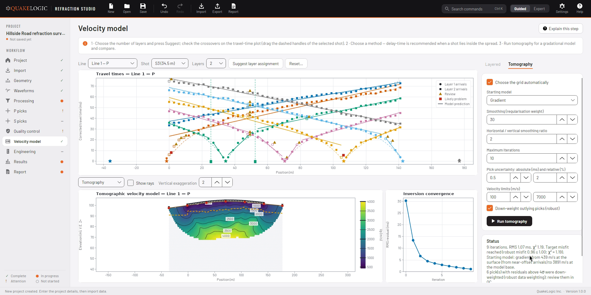
</p>

## Contents

* [Overview](#overview)
* [Download and installation](#download-and-installation)
* [Client package](#client-package)
* [Field guide](#field-guide-setting-up-your-equipment)
* [Training video](#training-video)
* [Screenshots](#screenshots)
* [Features](#features)
* [Documentation](#documentation)
* [For developers](#for-developers)
* [Licence](#licence)

## Overview

Refraction Studio, by QuakeLogic Inc., takes a seismic refraction survey through the whole workflow in
one application: import SEG-2 or SEG-Y shot records, check the geometry, process and pick first
breaks, assign layers, compute layered and tomographic velocity models, derive Vs30 and elastic
parameters, review automatic quality checks and produce a branded PDF report.

* **Guided workflow.** Twelve steps — Project, Import, Geometry, Waveforms, Processing, P picks,
  S picks, Quality control, Velocity model, Engineering, Results, Report — each with its status, an
  explanation in Guided mode and context help (F1).
* **Nothing is lost.** Raw records are stored unchanged inside the project; every processing step,
  pick and interpretation change is recorded, undoable and listed in the processing history.
* **Transparent results.** Each automatic pick carries a confidence score with its reasons; values
  below the depth of investigation, extrapolated Vs30 and estimated densities are always labelled.
* **Built for P and SH.** Separate lines, SH left/right impact pairs combined automatically, and an
  SH polarity-divergence picker.

## Download and installation

1. Download the installer: **[RefractionStudio-1.0.0-win-x64-setup.exe](https://github.com/omerozgul11/ql-refract-studio/raw/main/download/RefractionStudio-1.0.0-win-x64-setup.exe)**
   ([SHA-256](https://github.com/omerozgul11/ql-refract-studio/raw/main/download/RefractionStudio-1.0.0-win-x64-setup.exe.sha256)), or the complete
   [client package](#client-package).
2. Run it and follow the steps. You can install for all users or only for yourself, add a desktop
   shortcut and open `.rfsx` projects with Refraction Studio.
3. Start Refraction Studio and try **Explore the sample** on the start page — a complete synthetic P
   and SH survey.

### System requirements

| | |
|---|---|
| Operating system | Windows 10 (version 1809 or later) or Windows 11, 64-bit |
| Disk space | about 250 MB |
| Screen | at least 1024 × 660 |
| Other software | none — the .NET runtime is included |

### Licensing

* **Full version on every installation:** no trial, no licence key, no activation and no internet
  connection needed.
* Uninstalling keeps your projects and settings.

### Current release (1.0.0)

* The installer is not code-signed yet, so Windows SmartScreen may show "Windows protected your PC".
  Check the SHA-256 checksum on the releases page, then choose *More info → Run anyway*.
* Update checks read the signed release manifest in this repository's `download/` folder.

## Client package

One zip with everything a new user needs, ready to send to a client:
**[Refraction-Studio-1.0.0-Client-Package.zip](https://github.com/omerozgul11/ql-refract-studio/raw/main/download/Refraction-Studio-1.0.0-Client-Package.zip)**
([SHA-256](https://github.com/omerozgul11/ql-refract-studio/raw/main/download/Refraction-Studio-1.0.0-Client-Package.zip.sha256)).

```
Refraction-Studio-1.0.0-Client-Package/
  START HERE.txt                            what is inside, install steps, first survey, support
  1 - Install Refraction Studio/            RefractionStudio-1.0.0-win-x64-setup.exe
  2 - Field Guide (set up your equipment)/  field guide (PDF)
  3 - Training Video/                       video (MP4), captions (SRT) and chapter list
  4 - User Guide/                           the complete illustrated user guide (PDF)
  5 - Product Datasheet/                    features and technical specifications (PDF)
  6 - Example field records/                P and SH SEG-2 shot records to practise the import
  Licence and notices/                      licence agreement and open-source notices
  SHA256SUMS.txt                            checksums of every file
```

Right-click the zip, choose **Extract All…**, then open **START HERE.txt**.

## Field guide: setting up your equipment

New to seismic refraction? The field guide covers the equipment list, planning the line and the shot
layout (end, off-end and interior shots), planting vertical and horizontal geophones, the seismograph
settings, recording P shots with a plate and SH shots with a shear beam struck from both ends,
elevations, checklists, a field sheet and troubleshooting, then the analysis in Refraction Studio.

**[Refraction Studio field guide (PDF)](docs/marketing/QuakeLogic-Refraction-Studio-Field-Guide.pdf)**

<p align="center"><a href="docs/marketing/QuakeLogic-Refraction-Studio-Field-Guide.pdf">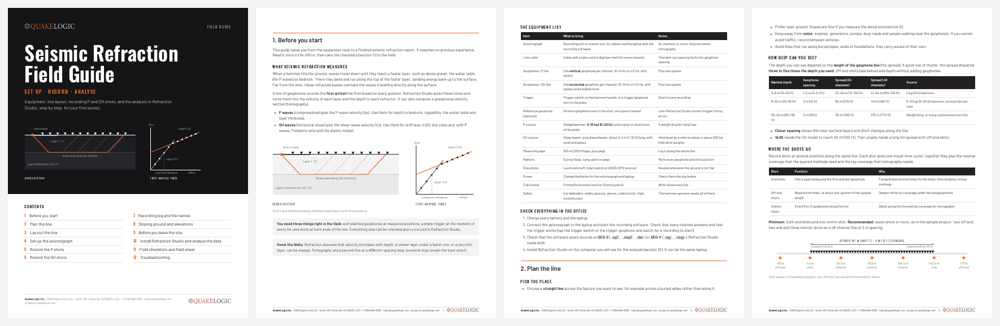</a></p>

## Training video

A six-minute narrated walkthrough of the complete workflow in the real application, from a new project
and the import of P-wave records to tomography, the SH line, Vs30 and the PDF report, with captions.

<p align="center"><a href="https://github.com/omerozgul11/ql-refract-studio/raw/main/download/Refraction-Studio-Training-1.0.0.mp4">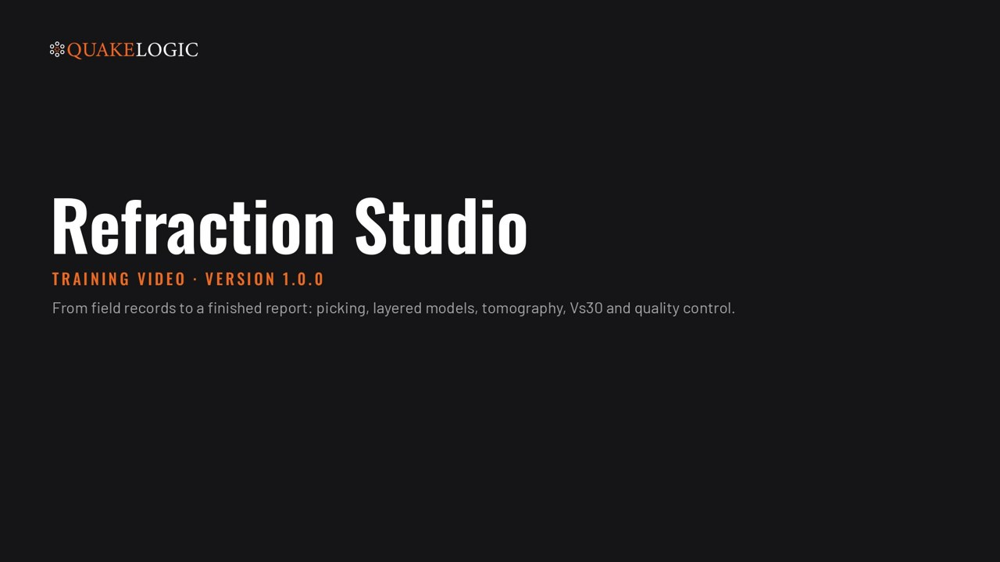</a></p>

**[Watch or download the training video (MP4)](https://github.com/omerozgul11/ql-refract-studio/raw/main/download/Refraction-Studio-Training-1.0.0.mp4)** ·
[captions (SRT)](download/Refraction-Studio-Training-1.0.0.srt) ·
[chapters](download/Refraction-Studio-Training-1.0.0-chapters.txt)

The [user guide (PDF)](docs/marketing/QuakeLogic-Refraction-Studio-User-Guide.pdf) explains every page
and setting, and the [datasheet (PDF)](docs/marketing/QuakeLogic-Refraction-Studio-Datasheet.pdf)
summarises the features and specifications:

<p align="center"><a href="docs/marketing/QuakeLogic-Refraction-Studio-Datasheet.pdf">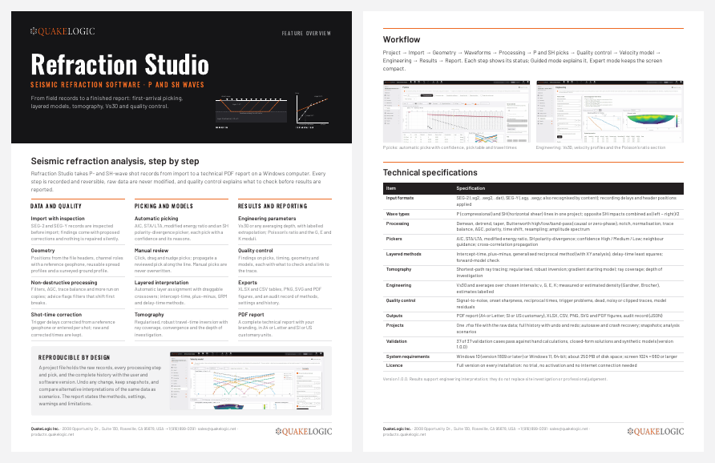</a></p>

## Screenshots

| | |
|---|---|
| 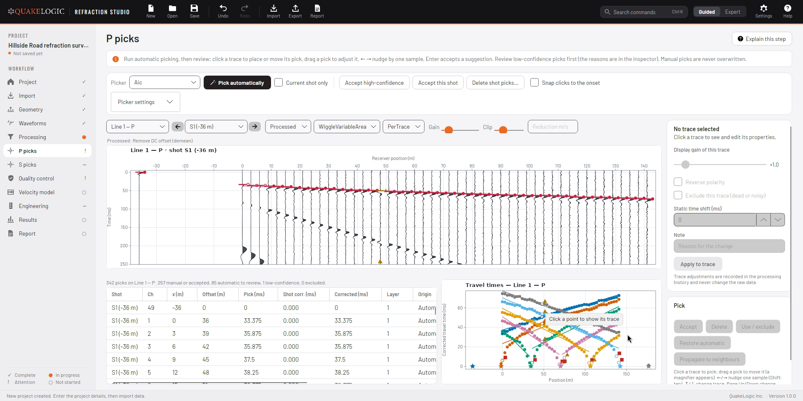 | 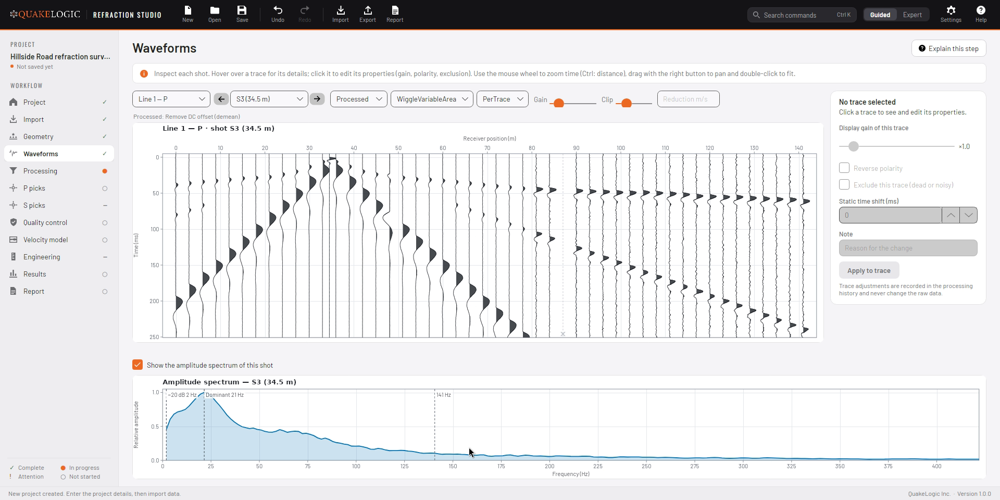 |
| **First-break picking** — automatic AIC, STA/LTA, energy-ratio and SH pickers; click, drag or nudge picks with the keyboard. | **Waveforms** — wiggle or variable-area display, gain, clipping, reduction velocity and the amplitude spectrum. |
| 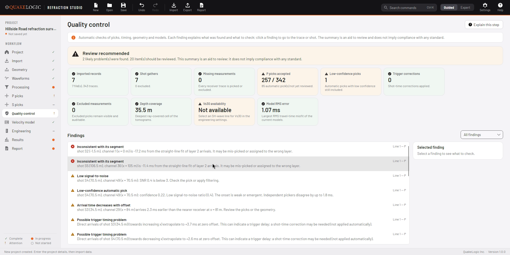 | 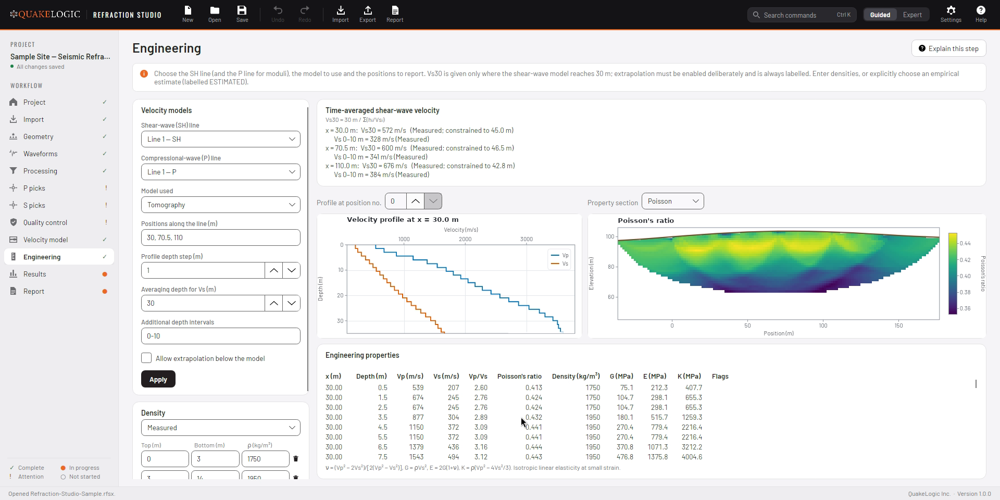 |
| **Quality control** — reciprocity, trigger errors, segment residuals, dead, noisy and reversed traces, with an overall verdict. | **Engineering** — Vs30 (or another depth), velocity profiles, Poisson's ratio and moduli sections. |
| 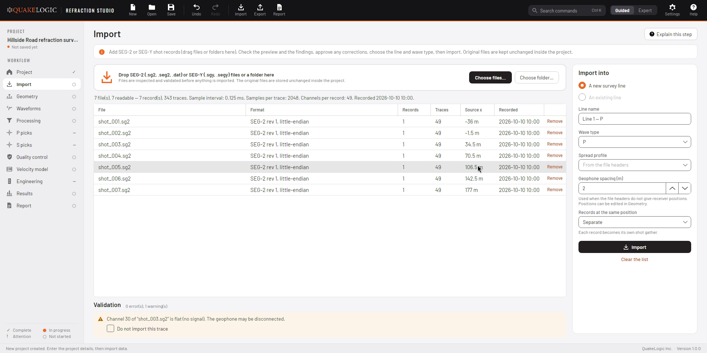 | 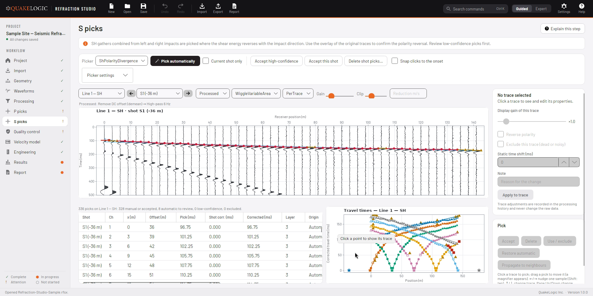 |
| **Import** — every file inspected before import; findings with corrections you approve. | **SH lines** — left and right impacts combined, picked with the SH polarity-divergence picker. |
| 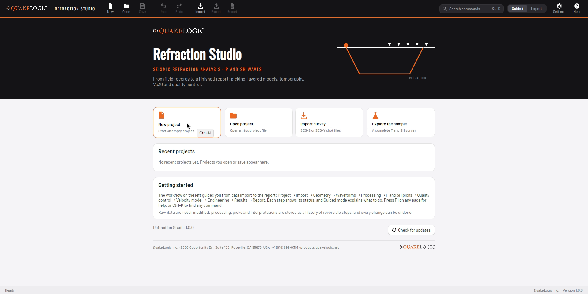 | 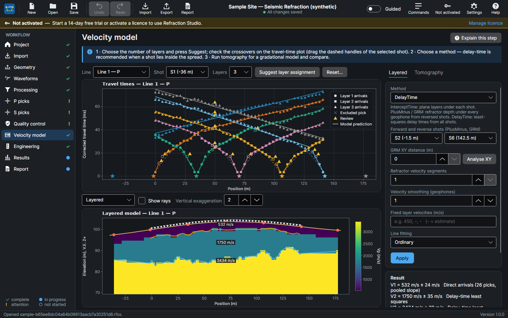 |
| **Start page** — new, open, import, the sample project and recent projects. | **Light and dark themes** — colour-vision-friendly palettes throughout. |

**PDF report** — cover, survey, processing, travel-time curves, layered and tomographic models,
profiles, Vs30, engineering parameters, QC, warnings and appendices, with your company branding:

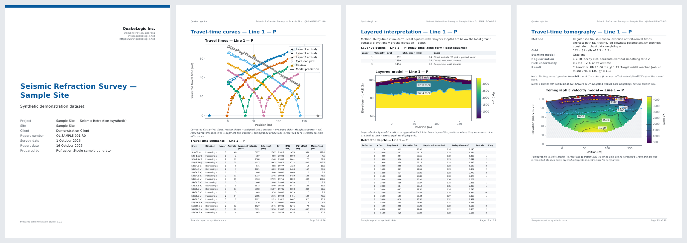

## Features

* **Import:** SEG-2 (`.sg2`, `.seg2`, `.dat`) and SEG-Y (`.sgy`, `.segy`, also recognised by content),
  with an inspection of every file and proposed fixes before anything is imported.
* **Geometry:** spreads, channel roles (including a reference/shot geophone), shot positions and
  depths, topography, reusable spread profiles.
* **Processing:** demean, detrend, taper, Butterworth high/low/band-pass (causal or zero-phase),
  notch, normalisation, trace balance, AGC, polarity, time shift and resampling; advice on filters
  that shift first breaks; shot-time (trigger) correction.
* **Picking:** AIC, STA/LTA, modified energy ratio and SH polarity-divergence pickers; confidence
  levels; neighbour guidance; cross-correlation propagation; manual picks that are never overwritten.
* **Interpretation:** automatic layer assignment with draggable crossovers; intercept-time,
  plus–minus, GRM (with XY analysis) and delay-time methods; forward-model check.
* **Tomography:** shortest-path ray tracing and regularised, robust travel-time inversion with
  ray coverage, convergence and depth of investigation.
* **Engineering:** Vs30 (or any averaging depth) with explicit, labelled extrapolation; ν, G, E, K;
  measured or estimated (Gardner, Brocher) density.
* **Results and exports:** scenario comparison, XLSX and CSV tables, PNG/SVG/PDF figures, an audit
  record, and the PDF report in A4 or Letter, SI or US customary units.
* **Projects:** one `.rfsx` file, autosave and crash recovery, snapshots and alternative
  interpretation scenarios.

## Documentation

* [Field guide (PDF)](docs/marketing/QuakeLogic-Refraction-Studio-Field-Guide.pdf) — equipment, line layout, recording P and SH shots ([source](docs/field-guide/FIELD-GUIDE.md)).
* [User guide (PDF)](docs/marketing/QuakeLogic-Refraction-Studio-User-Guide.pdf) — the same guide is built into the application (F1) ([source](docs/user-guide/USER-GUIDE.md)).
* [Datasheet (PDF)](docs/marketing/QuakeLogic-Refraction-Studio-Datasheet.pdf) — features and technical specifications.
* [Training video (MP4)](https://github.com/omerozgul11/ql-refract-studio/raw/main/download/Refraction-Studio-Training-1.0.0.mp4) — six-minute narrated walkthrough ([how it is made](marketing/training/README.md)).
* [Scientific validation](docs/SCIENTIFIC-VALIDATION.md) — synthetic cases with known answers and the latest results.
* [Algorithms](docs/algorithms/) — processing, picking, layer assignment, layered methods, tomography, QC, engineering.
* [Reports and exports](docs/REPORTING.md) · [File formats](docs/file-formats/) · [Security](docs/SECURITY.md)

## For developers

Refraction Studio is written in C# on .NET 10 with an Avalonia 12 user interface. This repository
also contains the licensing back end (licence server and admin portal, `server/`) and a command-line
tool that runs the same analysis engine without the user interface.

### Configuration and secrets

Nothing secret is stored in the repository. Local release settings (release-signing key path,
code-signing command, download URL) go in `.env` (template: [`.env.example`](.env.example)); the
licence-server deployment uses `server/.env` (template: [`server/.env.example`](server/.env.example))
and key files in `server/secrets/`. Private keys are kept in `.secrets/`. All of these are listed in
`.gitignore`. The public keys in `src/RefractionStudio.Infrastructure/Keys/` are meant to be public:
the application uses them to verify licences and updates.

### Repository layout

```
RefractionStudio.sln          solution (applications, libraries, server, tests, CLI)
Directory.Build.props         common build settings (net10.0, nullable, warnings as errors)
Directory.Packages.props      central package versions
global.json                   .NET SDK 10.0.401 (rollForward latestFeature)
src/
  RefractionStudio.Domain            immutable project model, ids, units
  RefractionStudio.SignalProcessing  FFT, Butterworth SOS, filters, AGC, resampling, correlation
  RefractionStudio.Formats           SEG-2 reader/writer, SEG-Y reader, import inspection
  RefractionStudio.Analysis          picking, travel times, layered methods, tomography, QC, engineering
  RefractionStudio.Persistence       .rfsx container, migrations, SQLite catalogue, recovery store
  RefractionStudio.Core              project workspace and session (undo/redo, history), import, traces
  RefractionStudio.Visualization     SkiaSharp renderers and figure export
  RefractionStudio.Reporting         PDF report, XLSX/CSV tables, audit export
  RefractionStudio.Licensing         licence client: fingerprint, tokens, store, state machine
  RefractionStudio.Infrastructure    settings, logging, crash handling, diagnostics, updater, help
  RefractionStudio.Synthetics        synthetic surveys with known answers, sample project builder
  RefractionStudio.App               Avalonia desktop application
server/                       licence server, admin portal, EF Core data layer, docker-compose.yml
tools/RefractionStudio.Cli    command-line tool (analyze, report, export, sample, validate, keys, sign-manifest)
tests/                        xUnit v3 test projects (see docs/TESTING.md)
samples/                      Refraction-Studio-Sample.rfsx (synthetic sample project)
packaging/                    Windows packaging script, Inno Setup script, EULA, third-party notices, client package
download/                     published installer, update manifest, client package zip, training video
marketing/                    PDF documents (documents/), training video (training/), media toolbox (toolbox/)
testenv/                      local test environment: the Linux build in the browser (noVNC), in Docker
docs/                         documentation (index below)
```

### Quick start

Prerequisites: the .NET SDK 10.0.401 (or a later patch in that feature band). If the repository has
the project-local SDK in `.tools/dotnet`, use it with `source .tools/env.sh`. Details:
[docs/BUILD.md](docs/BUILD.md).

```bash
source .tools/env.sh                                   # optional: project-local SDK

dotnet build RefractionStudio.sln                      # warnings are errors

dotnet test tests/RefractionStudio.Analysis.Tests      # one test project; see docs/TESTING.md
                                                       # (server tests need Docker)

dotnet run --project src/RefractionStudio.App          # start the desktop application

# analysis engine from the command line
dotnet run --project tools/RefractionStudio.Cli -- analyze samples/Refraction-Studio-Sample.rfsx
dotnet run --project tools/RefractionStudio.Cli -- report  samples/Refraction-Studio-Sample.rfsx --out sample.pdf
dotnet run --project tools/RefractionStudio.Cli -- validate --out docs/validation
```

The sample project (`samples/Refraction-Studio-Sample.rfsx`) is built from synthetic data with known
answers; it can be regenerated with
`dotnet run --project tools/RefractionStudio.Cli -- sample --out samples/Refraction-Studio-Sample.rfsx`.
In the application, "Explore the sample" on the start page opens a copy of it.

Version 1.0 is the full version: `AppInfo.LicensingEnforced` is false, so no licence is needed. The
licensing client, server and tests stay in place for when the licence server is deployed.

**Test in a web browser:** `testenv/start.sh` runs the Linux build of the application in Docker and
prints the addresses: the application through noVNC on port 50020 and a file browser for test data,
reports and exports on port 50021 (both on 127.0.0.1; use an SSH tunnel from another computer).
`testenv/stop.sh` stops it.

### Full documentation index

| Document | Contents |
|---|---|
| [ARCHITECTURE.md](ARCHITECTURE.md) | layers, principles, domain model, editing model |
| [docs/user-guide/USER-GUIDE.md](docs/user-guide/USER-GUIDE.md) | user guide (also the in-application help) |
| [docs/BUILD.md](docs/BUILD.md) | prerequisites, SDK, build settings, running, CLI, sample project |
| [docs/TESTING.md](docs/TESTING.md) | test projects, how to run them, golden files, UI tests |
| [docs/SCIENTIFIC-VALIDATION.md](docs/SCIENTIFIC-VALIDATION.md) | validation cases, latest results, limitations |
| [docs/validation/validation-report.md](docs/validation/validation-report.md) | latest generated validation report |
| [docs/DEPLOYMENT.md](docs/DEPLOYMENT.md) | Windows packaging, installer, code signing, updates, release checklist |
| [docs/SECURITY.md](docs/SECURITY.md) | desktop threat model and controls |
| [docs/REPORTING.md](docs/REPORTING.md) | PDF report, tables, figures, exports |
| [docs/algorithms/signal-processing.md](docs/algorithms/signal-processing.md) | processing steps and filters |
| [docs/algorithms/picking.md](docs/algorithms/picking.md) | first-break picking and confidence |
| [docs/algorithms/layer-assignment.md](docs/algorithms/layer-assignment.md) | travel-time segment (layer) assignment |
| [docs/algorithms/layered-methods.md](docs/algorithms/layered-methods.md) | intercept-time, plus–minus, GRM, delay-time |
| [docs/algorithms/tomography.md](docs/algorithms/tomography.md) | ray tracing and travel-time tomography |
| [docs/algorithms/qc.md](docs/algorithms/qc.md) | quality-control flags, cards and verdict |
| [docs/algorithms/engineering.md](docs/algorithms/engineering.md) | profiles, Vs30, elastic parameters, density |
| [docs/file-formats/seg2.md](docs/file-formats/seg2.md) | SEG-2 reader and writer |
| [docs/file-formats/segy.md](docs/file-formats/segy.md) | SEG-Y reader |
| [docs/file-formats/project-file.md](docs/file-formats/project-file.md) | `.rfsx` project container |
| [docs/licensing/LICENSE-SERVER.md](docs/licensing/LICENSE-SERVER.md) | licence server: API, keys, data model, deployment |
| [docs/licensing/ADMIN-PORTAL.md](docs/licensing/ADMIN-PORTAL.md) | admin portal for licences, customers and releases |

## Licence

Proprietary. Copyright © 2026 QuakeLogic Inc. The end-user licence agreement is
`packaging/windows/EULA.txt`; bundled open-source components are listed in
`packaging/windows/THIRD-PARTY-NOTICES.txt`.
